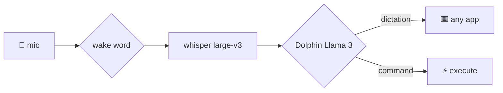
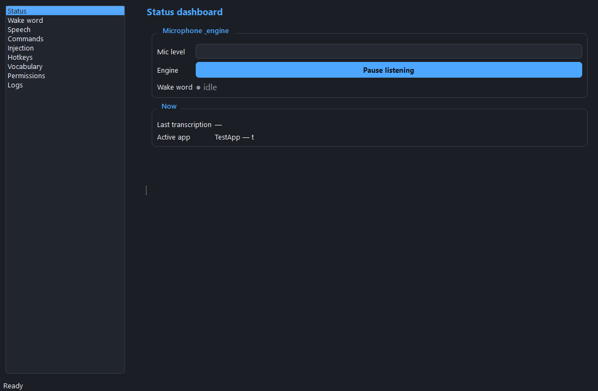
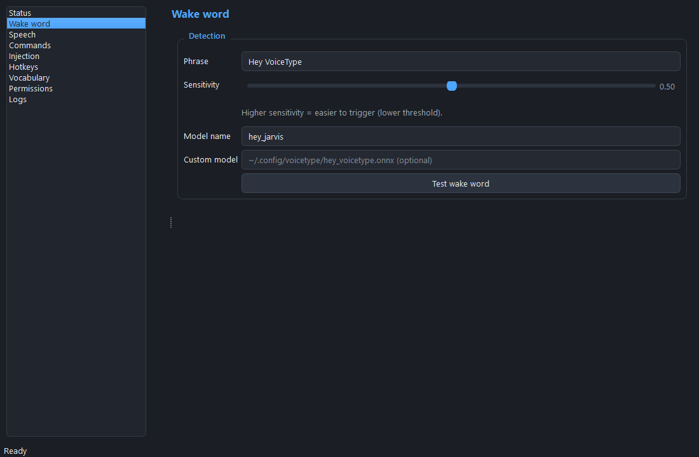
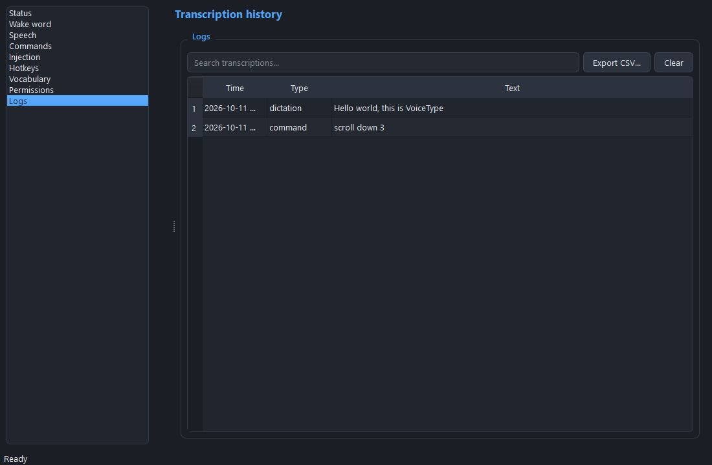

<div align="center">

# 🎙️ VoiceType

**The voice-first keyboard replacement that never phones home.**

Say *"Hey VoiceType"* and keep typing — with your voice — in **every app** on
macOS, Windows, and Linux. 100% local. No cloud, no account, no plugins.

[](https://github.com/seraphonixstudios/Voice-type-/actions/workflows/ci.yml)
[](pyproject.toml)
[](docs/WHITEPAPER.md)
[](#per-platform-setup)
[](LICENSE)

[Whitepaper](docs/WHITEPAPER.md) · [Security](SECURITY.md) · [Contributing](CONTRIBUTING.md) · [Mobile companion](mobile/README.md)

</div>

---

## ✨ Why VoiceType?

| | VoiceType | Cloud dictation tools |
|---|---|---|
| Audio leaves your machine | **Never** | Always |
| Account / subscription | **None** | Required |
| Works offline | **Yes** | No |
| Works in *every* app, no plugins | **Yes** (OS input layer) | Varies |
| Types things you didn't say | **No** (triple anti-phantom gates) | 😅 |

**Pipeline:** `sounddevice` 16 kHz mono → ring buffer → `openWakeWord`
("Hey VoiceType") → `faster-whisper large-v3` (VAD + batches + confidence
filter) → Dolphin Llama 3 via Ollama (`DICTATION` / `COMMAND
{"action","target","value"}`) → dictation injected into the focused app,
commands executed directly (delete, new paragraph, switch app, scroll, undo…).



## 📸 Control center





Dark-themed PySide6 control center: live mic meter, wake indicator, last
transcription, active app, wake/speech/command/injection/hotkey/vocabulary
pages, one-click permission fixes, searchable transcript history — every
setting persists to YAML and reloads **live, no restart**.

## 🚀 Quickstart (all platforms)

```bash
pip install -r requirements.txt
pip install -e .
ollama pull dolphin-llama3:8b && ollama serve   # local command parser
voicetype --check     # print resolved config
voicetype             # tray app  ·  voicetype --no-tray  # headless
```

Say **"Hey VoiceType"**, speak, pause — text appears in the focused app.

## 🖥️ Per-platform setup

### macOS
Grant **Accessibility** + **Microphone**: System Settings → Privacy &
Security → enable your terminal / VoiceType. Injection via `CGEvent`,
context via the Accessibility API. Optional: `pip install ".[mac]"`.

### Windows
Allow mic access (Settings → Privacy → Microphone); run elevated once for
admin windows. Injection via `SendInput` (Unicode + RTF), context via UI
Automation. Optional: `pip install ".[windows]"`.

### Linux (X11 + Wayland)
```bash
sudo usermod -aG input,audio $USER
pip install ".[linux]"
```
Injection via `uinput` (falling back to `xdotool` / `wtype` / `ydotool`),
context via AT-SPI. If `/dev/uinput` is unavailable, fallback tools still type.

## 🎛️ Commands

| Say | Action |
|---|---|
| "delete last 3 words" / "delete line" | Delete |
| "new paragraph" | Double newline |
| "switch to Firefox" | Focus/open app |
| "scroll down 3" | Scroll |
| "undo" | Undo (Cmd/Ctrl+Z) |

Anything else is typed as dictation — with unicode (`café 中`), multiline,
and code-indentation support.

## 🔌 Universal integration — every app, no plugins

VoiceType injects through the OS input layer, so any app that takes keyboard
input just works: raw keycodes in terminals, plain text in address bars and
password fields, RTF in Word, indentation-preserving code in IDEs,
composition events for IME apps. Passwords are **never logged**. Games with
anti-cheat are refused with a clear warning instead of risking your account.
Full 60-app test matrix in `tests/test_universal_integration.py`.

## 📱 Mobile companion

Your phone as LAN remote mic + command palette — TLS WebSocket, QR pairing,
mDNS discovery, no cloud. [`mobile/`](mobile/) (Flutter) + `voicetype
--companion`. Setup: [mobile/README.md](mobile/README.md).

## ⚠️ Known limitations, stated plainly

- **Anti-cheat is a hard block** (Vanguard, BattlEye, EAC…) — kernel-level,
  no workaround; use clipboard mode outside the match.
- Some hardened **macOS secure fields** drop injected keystrokes; fallback
  tries clipboard paste, then warns.
- A mic muted in one place isn't muted everywhere — if behavior surprises
  you, run `voicetype --list-mics` and pin `audio.device` (tray meter shows
  the live input).
- iOS companion must stay foregrounded while dictating (platform limit).

## 🧪 Tests

```bash
pip install -e ".[test]"
pytest -q   # 350 tests · 90% coverage gate enforced
```

Covers wake word, transcription, parsing, injection, context, config, UI,
integration matrix, companion protocol, and end-to-end pipeline.

## 📄 Docs

- [Whitepaper](docs/WHITEPAPER.md) — architecture, anti-phantom design,
  security model, evaluation, roadmap
- [Security policy](SECURITY.md) · [Contributing](CONTRIBUTING.md)

## 📜 License

MIT — see [LICENSE](LICENSE). © 2026 Seraphonix Studios.
