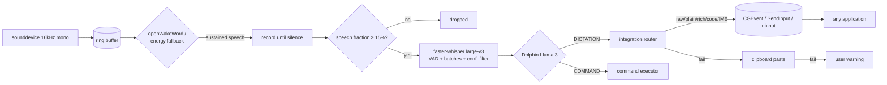

# VoiceType whitepaper

*Local-first voice keyboard replacement for macOS, Windows, and Linux.
Version 1.0 — companion to the implementation in this repository.*

## 1. Problem

Cloud dictation tools send microphone audio and keystrokes to third-party
servers, require accounts, and stop working offline. Power users who live in
terminals, IDEs, and browsers need a keyboard replacement that is private by
construction, works in **every** application without per-app plugins, and
never types anything the user didn't say.

## 2. Design principles

1. **Local-first, no exceptions.** STT (faster-whisper `large-v3`), wake
   word (openWakeWord), and command parsing (Dolphin Llama 3 via Ollama) all
   run on-device. The only network traffic in the entire system is the
   optional phone companion, confined to the LAN behind pinned TLS.
2. **OS-layer integration, never app APIs.** Text and commands are injected
   through CGEvent (macOS), SendInput (Windows), and uinput (Linux). Any app
   that accepts keyboard input works automatically — classification only
   selects *strategy* (raw keycodes vs plain vs RTF vs IME composition),
   never per-app code paths.
3. **Anti-phantom by construction.** Three independent gates stand between
   ambient noise and your editor (Section 5). Silence must never become text.
4. **Secrets never persist.** Password fields and password managers get
   plain-only injection; logs hold a redaction marker, and event fragments
   are scrubbed.

## 3. Architecture

**Module map** (`src/voicetype/`): `capture`, `audio_ring`, `wake`,
`transcriber`, `ollama_parser`, `injector`, `integration/` (`categories`,
`detectors`, `strategies`, `router`), `context_layer`, `pipeline`,
`settings_store`, `config_manager`, `permissions`, `theme`, `ui_main`,
`tray`, `app`, `companion/` (`pairing`, `server`, `discovery`).

## 4. Voice pipeline

| Stage | Implementation | Key parameters |
|---|---|---|
| Capture | sounddevice, 16 kHz mono float32 | `audio.device` pinning, 80 ms chunks |
| Wake | openWakeWord model, else energy fallback | `threshold`, `trigger_frames: 6` (~0.5 s sustained), `refractory_seconds` |
| Utterance | ring pre-roll + record-until-silence | `end_silence_ms`, `max_seconds`, `min_speech_fraction: 0.15` |
| STT | faster-whisper large-v3, GPU/CPU auto | VAD filter, batch windows of 16 s, `no_speech_threshold: 0.6`, `log_prob_threshold: -1.0` |
| Parse | Dolphin Llama 3 via Ollama | `DICTATION:` vs `COMMAND: {action,target,value}`; heuristic fallback offline |
| Act | integration router / command executor | per-category strategy, clipboard fallback chain |

## 5. Anti-phantom design

Three real incidents shaped this section — including typing that continued
with the microphone muted, which proved the trigger wasn't acoustic at all
but a wrong-device capture plus missing gates:

1. **Sustained-trigger gate** (`wake.py`): the energy fallback demands ~0.5 s
   of consecutive speech-like frames. A cough, clack, or music transient
   resets the streak and can never start a recording. A real openWakeWord
   verdict still fires immediately.
2. **Hallucination filter** (`transcriber.py`): configured `no_speech` /
   `logprob` thresholds are passed to faster-whisper *and* enforced as a
   post-filter, so "thanks for watching"-style noise artifacts are dropped.
3. **Speech-fraction gate** (`pipeline.py`): utterances below 15% speech are
   discarded before the model ever wakes.
4. **Pause enforcement**: `handle_audio` honors the listening switch, so a
   stuck push-to-talk path cannot inject while paused.
5. **Device pinning** (`audio.device` + `--list-mics`): multi-input machines
   (webcam + headset + USB mic) routinely listen on the wrong device; the
   app logs its active input at startup and the tray meter exposes it live.
6. **Hermetic test harness**: the project's own suite once typed into the
   developer's focused window — two tests drove a real `SendInputInjector`
   without OS fakes. Backend tests now universally fake Quartz/SendInput/
   evdev, a conftest fixture neuters `pynput` suite-wide, and a tripwire
   test fails if interception is ever removed. Test doubles that can reach
   the real world are treated as a safety defect, not a style issue.

## 6. Universal integration

Classification is substring fingerprinting over app name/bundle/title into
`terminal | browser | office | ide | game | password_manager | generic`,
combined with the focused element's accessibility role
(Accessibility/UIA/AT-SPI, each with graceful `unknown` degradation):

- Terminals → raw keycodes (Enter/Tab/Escape as real events, no printable
  conversion); Windows consoles additionally use virtual-key codes.
- Browser chrome/passwords → markdown-stripped plain text; contenteditable →
  markdown preserved.
- Office → RTF where supported (CF_RTF on Windows), plain fallback.
- IDEs → indentation-preserving code injection.
- Linux IME targets → preedit/commit composition events.
- Password managers + secure roles → plain-only, redacted, scrubbed.
- Games + detected anti-cheat (EasyAntiCheat, BattlEye, Vanguard, …) →
  injection refused with an explicit warning.
- Context failure → plain text, no formatting. Never nothing, never rich.

The representative-app matrix (`tests/test_universal_integration.py`, 20+
apps × 3 platforms) locks this behavior in.

## 7. Companion security model

LAN-only TLS WebSocket server. First run mints a self-signed RSA-2048
certificate; the phone pins its SHA-256 fingerprint from the QR payload
(TOFU — verify on both screens). Setup uses a single-use 10-minute pairing
token exchanged for a per-device credential stored hashed with `0600`
permissions. mDNS advertises `_voicetype._tcp.local.`; without `zeroconf`,
QR/manual pairing still works. iOS cannot record in the background, so the
app must stay foregrounded while dictating.

## 8. Evaluation

- **400+ tests, 100% line + branch coverage**, enforced by pytest-cov in CI
  (macOS / Windows / Linux × Python 3.10 / 3.12). Five lines carry
  `# pragma: no cover` with documented justification (abstract contracts,
  entry-point trampoline) — everything else is executed by the suite.
- Suites cover wake behavior (synthetic audio, similar-phrase rejection,
  silence), exact-transcript STT, VAD/batching, parser schema + malformed +
  offline paths, per-platform injection with mocked OS APIs, context/cursor
  focus semantics, config round-trip + corrupt recovery, UI rendering and
  persistence, and end-to-end audio-in/text-out integration.
- Coverage reports: `pytest --cov=src/voicetype --cov-report=html`.

## 9. Limitations (stated plainly)

- Kernel anti-cheat is a hard block; no user-space trick bypasses it.
- Hardened macOS secure fields can drop injected keystrokes; the fallback
  chain tries clipboard paste, then warns.
- Console Unicode is unreliable (code pages) → clipboard step.
- Wayland clipboard tooling varies (`wl-copy` vs `xclip`).
- A muted mic in one app never mutes the machine: always confirm the active
  input (`--list-mics`, tray meter) when behavior surprises you.

## 10. Roadmap

Custom "Hey VoiceType" openWakeWord model training guide, per-device
push-to-talk key forwarding from the phone, streaming partial transcripts,
and signed releases per platform.
